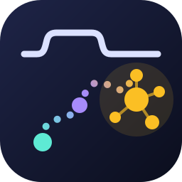
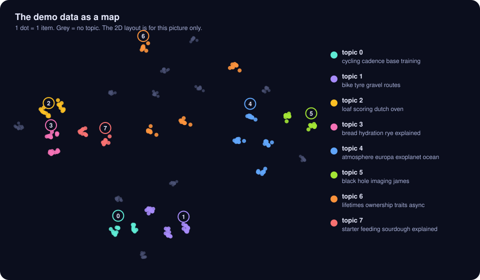
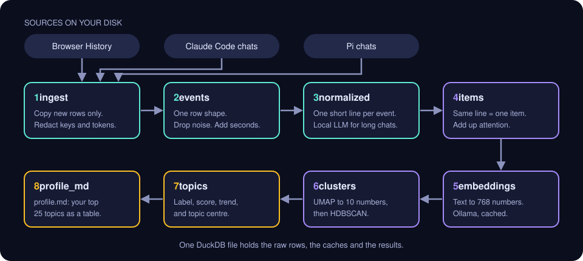
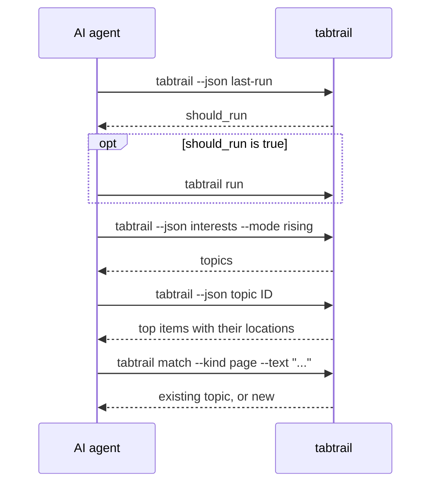

<p align="center">
  
</p>

<h1 align="center">tabtrail</h1>

<p align="center">
  <b>Turn your browser history and AI chats into a map of your interests.</b><br>
  The pipeline runs on your machine, with local models.
</p>

<p align="center">
  <a href="LICENSE"></a>
  
  
  
</p>

<p align="center">
  <a href="#what-you-get">What you get</a> •
  <a href="#quick-start">Quick start</a> •
  <a href="#how-it-works">How it works</a> •
  <a href="#commands">Commands</a> •
  <a href="#use-it-from-an-ai-agent">AI agents</a> •
  <a href="#privacy">Privacy</a> •
  <a href="#limits">Limits</a>
</p>

<p align="center">
  
</p>

## Why

Your browser already records what you read and search. Your AI chat logs record what you ask. That data shows what you care about, but it is a long list of rows.

tabtrail turns those rows into **topics**. For each topic, it tells you:

- **how much** attention you gave it,
- **whether** the interest is rising, steady or fading,
- **where** it came from (browser, Claude Code or Pi),
- **whether new text belongs to it**, for example a headline in a feed.

## What you get

This output comes from the [demo data](examples/demo_history.py): 320 invented visits about Rust, space, cycling and bread.

```console
$ tabtrail interests
   1. topic 6    score   2.56   79% recent  rising  brave            lifetimes ownership traits async
   2. topic 4    score   1.98   51% recent  rising  brave            atmosphere europa exoplanet ocean
   3. topic 1    score   1.61   19% recent  steady  brave            bike tyre gravel routes
   4. topic 5    score   1.44   46% recent  steady  brave            black hole imaging james
   5. topic 7    score   1.22   37% recent  steady  brave            starter feeding sourdough explained
   6. topic 0    score   1.12    1% recent  fading  brave            cycling cadence base training
   7. topic 2    score   1.04   10% recent  fading  brave            loaf scoring dutch oven
   8. topic 3    score    1.0   29% recent  steady  brave            bread hydration rye explained
```

The labels are the top words of each topic. They are not sentences. One subject can also become more than one topic. In the demo, bread is topics 2, 3 and 7.

## Quick start

### What you need

| Need | Why |
|---|---|
| [uv](https://docs.astral.sh/uv/) | Installs Python and the packages |
| [Ollama](https://ollama.com) | Makes the embeddings on your machine |
| Brave, Chrome, Edge or Arc | The history source. Brave is the default and the most used |
| Apple Silicon (optional) | Summarizes long chat messages with a local model |

### Try it with the demo data

These steps do not read your own history.

```sh
git clone https://github.com/arjunprakash027/tabtrail.git
cd tabtrail
uv sync
ollama pull nomic-embed-text      # Ollama must be running

export TABTRAIL_HOME=/tmp/tabtrail-demo/data
export TABTRAIL_PROFILE=/tmp/tabtrail-demo/profile
export TABTRAIL_SOURCES=brave TABTRAIL_LINES=truncate

uv run python examples/demo_history.py "$TABTRAIL_PROFILE"
uv run tabtrail run
uv run tabtrail interests
```

The demo dates count back from today. Your numbers can differ a little from the numbers on this page.

### Use your own data

Open a new terminal, or remove the four demo variables. Then choose one line:

```sh
uv sync --extra mlx                 # Apple Silicon: local summaries of long chat messages
export TABTRAIL_LINES=truncate      # all other machines: use the first 30 words
```

```sh
uv run tabtrail run
uv run tabtrail interests --mode rising
```

- **macOS:** give your terminal Full Disk Access if it cannot read the History file.
- **First run with MLX:** tabtrail downloads the summary model from Hugging Face. It summarizes at most 200 new messages in each run. One message takes 1 to 2 seconds on an 8 GB M1.
- **Command on your PATH:** run `uv tool install --editable .` (add `--with mlx-lm` for MLX). Then type `tabtrail` in place of `uv run tabtrail`.

## How it works

<p align="center">
  
</p>

The pipeline is an [Apache Hamilton](https://hamilton.apache.org) graph in [`tabtrail/pipeline.py`](tabtrail/pipeline.py). Each public function is one step. The names of its parameters are the steps that it needs. `tabtrail graph` prints these links.

### Follow one page through the pipeline

An invented example:

```text
 History row   title "(3) Rust ownership explained - YouTube", in front for 412 s
     │
     ▼  ingest       copy the row into DuckDB (only if it is new)
     ▼  events       remove "(3)" and "- YouTube"          attention = 412 s
     ▼  normalized   short text stays as it is             "Rust ownership explained"
     ▼  items        join all events with the same line    attention = sum of the events
     ▼  embeddings   [ 768 numbers ]                       similar meaning, similar numbers
     ▼  clusters     [ 10 numbers ] ──► a dense group      or no topic
     ▼  topics       label, score, trend, centre
     ▼  profile_md   one row in profile.md, if the topic is in the top 25
```

### What counts as attention

| Event | Attention |
|---|---|
| A page | Time the tab was in front. At most 30 minutes for each visit |
| A search | 30 seconds (fixed) |
| A chat message that you typed | 120 seconds (fixed) |

tabtrail removes noise before it counts:

- Pages with less than 10 seconds in front and less than 10 seconds open.
- Mail, calendar, sign-in and localhost pages.
- Generic titles, such as "Login", "New Tab" or "YouTube".
- Chat replies, such as "continue" or "try again", and messages with fewer than 4 words.
- Chat messages that match the known patterns of agents and plugins.

### Score and trend

```text
score        = hours of attention  +  events / 120
recent share = attention in the last 14 days  /  all attention
```

| Recent share | Trend |
|---|---|
| 50% or more | rising |
| 15% to 49% | steady |
| less than 15% | fading |

The 14 days end at your newest event. See [How scores are calculated](docs/scores.md).

### How new text finds a topic

Each topic has a **centre**: the average of its vectors. Each topic also has its own **cut**: 90% of its own items are at least this similar to the centre. New text joins the closest topic only if it passes the cut of that topic.

```text
                                                           similarity     cut
 "sourdough starter feeding schedule"  ──► topic 7           0.923   ≥   0.911   joins
 "how do rust lifetimes work"          ──► topic 6           0.810   <   0.828   new (a near miss)
 "How to repot a monstera plant"       ──► topic 4 (nearest) 0.742   <   0.854   new
```

The second line shows a limit of this rule. The text is about Rust, but it is just below the cut.

For the full method, with UMAP, HDBSCAN and TF-IDF examples, read [The maths inside tabtrail](docs/math.md).

## Commands

| Command | What it does |
|---|---|
| `tabtrail run [--to STEP]` | Runs the pipeline. Can stop after one step |
| `tabtrail interests [--mode top\|recent\|rising\|fading] [--source brave\|claude\|pi] [--limit N]` | Lists your topics |
| `tabtrail topic ID [--limit N]` | Shows one topic and its top items |
| `tabtrail match --kind search\|page\|chat --text "..." [--mlx]` | Shows which topic new text would join. Does not save the text |
| `tabtrail profile` | Prints `profile.md` |
| `tabtrail status` | Counts the stored rows |
| `tabtrail last-run` | Shows the last run and tells you if a new run is necessary |
| `tabtrail graph` | Shows each step and the steps that it needs |

To get JSON, put `--json` **before** the command: `tabtrail --json interests`. All commands except `interests` and `profile` print JSON by default.

<details>
<summary><b>Example:</b> <code>tabtrail topic 0 --limit 1</code></summary>

```json
{
 "topic_id": 0,
 "words": "cycling cadence base training",
 "score": 1.12,
 "last_14_days_pct": 1.0,
 "trend": "fading",
 "items": 20,
 "events": 20,
 "attention_h": 0.95,
 "sources": "brave",
 "rank": "6 of 8",
 "top_items": [
  {
   "text": "Common mistakes with cycling base training",
   "attention_min": 7.8,
   "events": 1,
   "last_seen": "2026-10-21",
   "sources": "brave",
   "example_location": "https://cyclingweekly.com/233"
  }
 ]
}
```

</details>

A topic ID is valid only for the latest run. A new run can give a topic a different ID.

## Use it from an AI agent



> [!WARNING]
> If your agent uses a cloud model, the output that it reads goes to that model provider. `topic` output includes titles, chat text, URLs and file paths.

## Settings

Set these environment variables.

| Variable | Default | Meaning |
|---|---|---|
| `TABTRAIL_HOME` | `data/` in the checkout (`~/.local/share/tabtrail` for a normal package install) | Location of the database, `profile.md` and the MLX model files |
| `TABTRAIL_BROWSER` | `brave` | `brave`, `chrome`, `edge` or `arc` |
| `TABTRAIL_PROFILE` | found from the browser | Folder that contains the `History` file |
| `TABTRAIL_SOURCES` | `brave,claude,pi` | Sources to read. `brave` is the browser source for all four browsers |
| `TABTRAIL_CLAUDE_DIR` | `~/.claude/projects` | Claude Code logs |
| `TABTRAIL_PI_DIR` | `~/.pi/agent/sessions` | Pi logs |
| `TABTRAIL_LINES` | `mlx` | `mlx` or `truncate`, for long chat messages |
| `TABTRAIL_LINES_PER_RUN` | `200` | Maximum new summaries in each run |
| `TABTRAIL_LLM_MODEL` | `mlx-community/Qwen3-1.7B-4bit` | Summary model |
| `TABTRAIL_OLLAMA` | `http://localhost:11434` | Ollama address |
| `TABTRAIL_EMBED_MODEL` | `nomic-embed-text` | Embedding model |
| `TABTRAIL_MIN_SECONDS` | `10` | Minimum time for a page to count |
| `TABTRAIL_RECENT_DAYS` | `14` | Length of the recent window |
| `TABTRAIL_STALE_HOURS` | `24` | Age at which `last-run` asks for a new run |

## Privacy

With the default settings, tabtrail sends your history and chats only to Ollama on your own machine. It has no telemetry. The model downloads need a network connection.

If you set `TABTRAIL_OLLAMA` to a remote address, tabtrail sends text to that machine.

**Protect the data folder. It is sensitive and it is not encrypted.**

- The database keeps all imported visits. This includes mail and sign-in pages. tabtrail removes them from the topics, not from the database.
- tabtrail replaces some common key and token formats with `[secret]` before it stores text. It cannot find all secrets. For example, it does not find a plain password.
- tabtrail only appends raw rows. If you delete browser history, the copy in tabtrail stays. To remove it, delete the data folder.
- tabtrail copies the browser's History file, reads the copy, then deletes the copy.
- `.gitignore` excludes `data/`. Do not commit it.

## Limits

- The 30 and 120 second values are estimates.
- The score adds hours to an event count. Searches and chat messages thus get weight two times.
- Topics need at least 50 items. A small history can give no topics.
- Topic labels are top words. Some labels are weak.
- `match` assumes that each topic is round around its centre.
- Only the latest run's topics are kept. tabtrail does not show how topics change between runs.
- Time in front comes from a browser table that not all Chromium browsers fill. Without it, a page gets 0 seconds of attention.
- The author uses tabtrail on macOS with Brave. Linux paths exist, but they are not tested.

## Project layout

```text
tabtrail/
├── tabtrail/
│   ├── pipeline.py     the 8 steps
│   ├── adapters.py     one reader for each source: brave, claude, pi
│   ├── query.py        read-only questions: interests, topic, match
│   ├── cli.py          the tabtrail command
│   ├── db.py           DuckDB tables
│   └── config.py       settings
├── examples/           demo data
├── tests/              pytest checks
├── benchmarks/         time for each step
└── docs/               scores, maths, pictures
```

## Development

```sh
uv run pytest                                              # tests
uv run pytest benchmarks/bench_steps.py --benchmark-autosave   # benchmarks, on a copy of your data/
```

To add a source, write one function in [`adapters.py`](tabtrail/adapters.py) and add it to `ALL`. A chat source can use the `chat_messages` table. Also add the source name to the `--source` choices in [`cli.py`](tabtrail/cli.py).

## License

[MIT](LICENSE)
